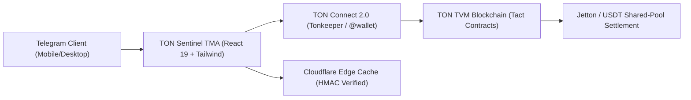

# TON Sentinel TMA (Telegram Mini App)

> **1-Click Decentralized Sentiment & Outcome Oracle on the TON Blockchain**  
> Developed for the TON Society Grants Program ($5,000 USDT)

---

## Architecture Overview



## Key Technical Pillars
1. **Zero-Download TMA Experience:** Launches natively in Telegram via `@twa-dev/sdk`.
2. **Deterministic Tact Smart Contracts:** Written in Tact 1.5, compiling to TVM BOC with actor-model safety.
3. **TON Connect 2.0:** Integrated with Tonkeeper, MyTonWallet, and native Telegram `@wallet`.
4. **Cryptographic Telegram Auth:** Validates `initData` using HMAC-SHA256 to ensure genuine Telegram identities.

---

## Milestone Roadmap ($5,000 USDT Grant)

| Milestone | Deliverables | Funding |
| :---: | :--- | :---: |
| **Milestone 1** | - Scaffold Vite + React 19 + Tailwind TMA<br>- Telegram WebApp SDK integration (theme, haptics)<br>- TON Connect 2.0 wallet modal setup | **$2,000 USDT** |
| **Milestone 2** | - Deploy Tact contract to TON Testnet<br>- Implement prediction deposits via TON Connect<br>- Automated Jest/Blueprint test suite (100% pass) | **$2,000 USDT** |
| **Milestone 3** | - Security audit of Tact contract<br>- Mainnet deployment & `@TonsentinelBot` launch<br>- Public documentation and community onboarding | **$1,000 USDT** |

---

## Smart Contract Specification (`contracts/TonsentinelPool.tact`)

```tact
contract TonsentinelPool with Deployable {
    owner: Address;
    marketId: Int as uint32;
    resolved: Bool;
    winningOutcome: Bool;
    totalYes: Int as coins;
    totalNo: Int as coins;
    ...
}
```

---

## Author & Verification
- Lead Developer: Pinyo Pattanawasanporn (`PINYOPATTANAWASANPORN`)
- Contact: `pattanawasanporn@gmail.com`
- License: MIT
